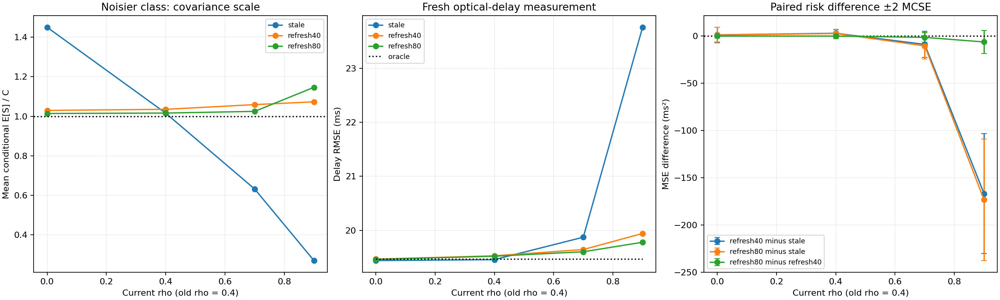

# Refreshing correlation calibration for optical camera timing

A **45–60 minute integrated learning lab**: an old noise characterization can be numerically precise and still give the wrong weights after conditions change. Follow a diffraction spot through camera sampling, subpixel localization, clock fitting and exposure-delay measurement; compare fixed-cost refresh policies after a controlled regime change.

## Objectives and prerequisites

Learn to derive covariance bias under transferred whitening, account for the acquisition cost of a refresh, and compare measurement risk on fresh data. Prerequisites: Gaussian covariance, least squares, elementary Fourier optics and Python. The previous [estimated-correlation lab](https://github.com/ahmetalpkilic/estimated-repeat-correlation-learning-lab) assumed transferability. This standalone experiment breaks that assumption without changing the marginal timestamp variance.

```sh
git clone https://github.com/ahmetalpkilic/correlation-refresh-optical-timing-learning-lab.git
cd correlation-refresh-optical-timing-learning-lab
sh run_demo.sh
```

Python 3.9–3.12 and POSIX shell. The one-command runner installs pinned dependencies in `.venv`, runs tests, and generates `outputs/results.json` and `outputs/experiment.png`. Initial installation requires internet; `.venv/bin/python lab.py` subsequently runs offline. Synthetic inputs only. Committed `examples/` outputs provide a deterministic reference in the tested environment; final digits may vary across platforms.

Suggested session: physical model 10 min, transfer derivation 10 min, code and experiment 15 min, validation and one exercise 15–25 min.

| Area | Explicit model | Connection |
|---|---|---|
| Optics | Fourier transform of a 550 nm Gaussian pupil | Determines the point-image width |
| Camera | 16 mm focal length, 4 µm integrated pixels, Gaussian read noise | Produces noisy image observations |
| Vision / metrology | Subpixel localization, known motion, affine clocks | Measures camera exposure delay |
| Mathematics | AR(1) regime change, profile REML, transferred GLS and paired risk | Quantifies the cost and value of refreshing a calibration |

## Optical and camera model

The pupil amplitude is `exp(-(rho_x²+rho_y²)/a²)`, with amplitude radius `a=1000 µm`, wavelength `lambda=0.550 µm`, and focal length `f=16000 µm`. This is an **untruncated Gaussian pupil**, not a uniform circular aperture or an f-number model. Scalar paraxial monochromatic Fourier optics, an aberration-free isolated point and instantaneous exposure are assumed.

The Fourier amplitude is proportional to `exp(-(pi*a*x/(lambda*f))²)`. Squaring gives intensity SD `lambda*f/(2*pi*a)`. At pixel pitch `p=4 µm`,

```text
sigma_px = lambda*f/(2*pi*a*p) = 0.350140875 px
mu_j(u) = B + F [Phi((j+0.5-u)/sigma) - Phi((j-0.5-u)/sigma)]
```

`Phi` is the standard-normal CDF; `F=10000 ADU`, `B=20 ADU`. The camera has square pixels, no distortion/skew, principal point `(0,0)` and `K=diag(4000,4000,1)` in pixels. We simulate the horizontal marginal of a separable 2-D PSF. Signed ROI pixel centers are `j=-16,...,+16`, increasing to the right; each integrates `[j-0.5,j+0.5]`. These are not top-left array coordinates.

Each marginal sample receives independent Gaussian read noise of SD 2 ADU. There is no shot noise, saturation, quantization, or photometry fitting; flux, background and optical width are known. Least squares fits `u` using the analytic pixel-integral derivative. This high-SNR toy model isolates clock uncertainty, not a full camera noise budget.

The independently known image trajectory is `u(r)=u0+v*r`, `u0=0.23 px`, `v=0.8 px/reference second`. Clocks obey `r=alpha*t+beta`: true `alpha=1.002 reference s/master s`, `beta=0.030 reference s`. A frame tagged `T=2.0 master s` was exposed at `T+delta`, with true delay `delta=0.040 master s`.

## A controlled change in the acquisition regime

Forty synchronization events have unknown means `(tau_i, alpha*tau_i+beta)`, with true master times evenly spaced in [-1,+1] s. They belong to two **known** alternating quality classes. Even events have clock SDs (.030,.020) s and within-pair correlation .5; odd events have SDs (.120,.040) s and within-pair correlation .3. Their 2×2 marginal covariances C_g have units s². These stay fixed throughout the experiment.

A calibration block repeats one unknown event mean m times: this is idealized replay, not advancing event time. Repeated errors obey `Cov(e_k,e_l)=rho_g^|k-l| C_g`. Blocks are independent and stationary internally. Repeat separation is an acquisition index, not a measured physical time scale.

Before a known regime boundary, two independent characterization sequences of 80 pairs each have true correlations (0,.4). After the boundary, the correlations become (0,rho), where rho is 0, .4, .7 or .9. Thus .4 is the **no-change control**, and 0 tests a decrease as well as .7/.9 testing increases. This is piecewise stationarity with an independent reset at the boundary; it is not gradual drift within a block. The exact change size is hidden from feasible policies.

Each characterization sequence has an unknown constant two-clock mean and covariance. Its fit receives only the sequence. Both class correlations are estimated, even when one is truly zero. Fresh characterization uses only the current regime and is independent of all repeat blocks, final timestamps and images.

## Equal lifetime acquisition budgets

| Policy | Old characterization | Fresh characterization | Current calibration | Total pairs |
|---|---:|---:|---:|---:|
| stale | 2×80 = 160 | 0 | 40×12 = 480 | 640 |
| refresh40 | 160 | 2×40 = 80 | 40×10 = 400 | 640 |
| refresh80 | 160 | 2×80 = 160 | 40×8 = 320 | 640 |

The old 160 pairs are a common sunk cost. Every policy then spends the same 480 new pairs. Refresh policies discard the old rho estimates, using the new estimates for current blocks. They do not pool incompatible regimes. Characterization covariance is profiled out and discarded by design; joint reuse could improve efficiency and is outside this two-stage lesson. Reset/settling costs are free, pair costs identical, and the regime boundary is externally known. No change detector or adaptive choice is evaluated.

`known12`, `known10`, `known8` are matched controls with exactly the corresponding number of calibration repeats, supplied the true current rho. They are infeasible free-information references, not budget competitors. `oracle` supplies exact C. All policies receive the same 40 **fresh, independent** final synchronization pairs and fresh noisy spot image, excluded as a common evaluation cost. These pairs have marginal C and are independent across events; they are not repeat averages.

## Derive the transfer failure

For one m×2 repeat block Z with constant unknown mean, write

```text
R_t[k,l] = rho_current^|k-l|
W_h = R(rho_assumed)^(-1)
Q_h = W_h - W_h 1 (1^T W_h 1)^(-1) 1^T W_h
S = Z^T Q_h Z / (m-1).
```

Since `Q_h 1=0`, the mean vanishes. Expanding the quadratic form entrywise gives

```text
E[S | rho_assumed] = kappa * C
kappa = tr(Q_h R_t)/(m-1).
```

At the correct correlation, `tr(Q_t R_t)=m-1`, so kappa=1. After a regime change, kappa generally differs from 1 **even with an infinitely long, perfectly estimated old characterization**. More old data cannot repair a transfer assumption. Independent finite-sample estimates add another layer: average this conditional factor over the characterization estimator. Independence prevents reuse bias but not nonlinear plug-in bias.

A common scalar multiplying every event covariance cancels from the clock objective. Here the two classes have different transfer factors; their relative weights change and affect delay risk. This is why the experiment changes only one class's temporal correlation while keeping both marginal covariances fixed.

`transfer_factor` is a diagnostic using truth; feasible policy estimation does not call it. Conditional factors are averaged in the report; they are expected covariance scales, not ratios of two random empirical variances.

```python
# Only independent old/fresh characterization estimates enter the policy.
n, m = POLICIES[name]
used = old_rhos if n == 0 else fresh_rhos[n]
# Take the allowed prefix, whiten, and pool within known quality classes.
S = estimate(repeats[:, :m], used[LABELS])
# Evaluate on new timestamps and an independent pixel-integrated spot image.
clock_fit = calibrate(x_fresh, y_fresh, S)
delay_hat = delay_from_center(fitted_center, clock_fit)
```

## Derive correlation estimation from mean-free data

For one characterization sequence `Z` of shape n×p with p=2:

```text
Z ~ matrix normal(1 mu^T, R(rho), C)
W = R^-1
Q = W - W1 (1^T W1)^-1 1^T W
A(rho) = Z^T Q Z
```

Q removes the unknown constant two-clock mean. To derive a restricted likelihood, choose any `(n-1)×n` orthonormal contrast matrix D with `D1=0`. Then `Y=DZ` has row covariance `V=DRD^T`, no unknown mean, and column covariance C. Minus twice its Gaussian log likelihood, omitting constants, is

```text
p log|V| + (n-1) log|C| + tr(C^-1 Y^T V^-1 Y).
```

Differentiating with respect to C gives `C_hat=A/(n-1)`; substitution makes the trace term `(n-1)p`, constant in rho. Using `D^T V^-1 D=Q` and `|V|=|R|(1^T W1)/n`, minimize

```text
J(rho) = p log|R| + p log(1^T W1) + (n-1) log|A/(n-1)|.
```

The omitted `-p log n` has no effect on the minimum. This is a profile **restricted** likelihood, not the ordinary likelihood with n degrees of freedom, and it does not guarantee an unbiased rho estimate at finite n.

For stationary AR(1), `|R|=(1-rho²)^(n-1)`. Its inverse is tridiagonal with end diagonal 1, interior diagonal `1+rho²`, and off-diagonal `-rho`, all divided by `1-rho²`. `reml_score` uses this identity in O(n) operations. No dense inverse is required. Subtracting the ordinary column mean first improves numerical stability because Q annihilates every constant.

```python
# The sequence is the only input: no true noise parameters enter this fit.
rho_hat = fit_rho(characterization)
# Select bounded minima of J on [-.95,.95]; keep and count boundary fits.
# Profile nuisance C is not used downstream in this experiment.
```

The code evaluates 39 grid points and refines all bracketed local minima, also considering endpoints. This is a reproducible numerical procedure, not a global-optimum proof for arbitrary data. The interval `[-.95,.95]` is an estimator assumption, not a confidence interval. Negative estimates remain allowed even when true rho=0. Boundary frequencies are reported so clipping cannot silently masquerade as exact recovery.

## From calibration weights to optical delay

Treat `S_i` as a plug-in covariance, temporarily fixed during each fit. With latent true time `tau_i`, minimize

```text
Q = sum_i [z_i-(tau_i,alpha*tau_i+beta)]^T S_i^-1
          [z_i-(tau_i,alpha*tau_i+beta)]
```

For `d=(1,alpha)`, differentiation gives

```text
tau_i* = d^T S_i^-1 (x_i,y_i-beta) / (d^T S_i^-1 d).
V_i(alpha) = alpha²*S_i,xx - 2*alpha*S_i,xy + S_i,yy
Q_profile = sum_i (y_i-alpha*x_i-beta)²/V_i(alpha)
beta*(alpha) = sum_i [(y_i-alpha*x_i)/V_i] / sum_i [1/V_i].
```

Search numerically over `alpha in [0.5,1.5]`. The implementation checks a 65-point grid, refines bracketed minima and rejects boundary/flat fits. This is not a global-optimum guarantee for arbitrary data. Independent full latent-event optimization validates the implemented objective. There is no `log V_i` term: this profiles fixed latent times; it does not marginalize random times. With estimated covariance, this is a **plug-in procedure**, not the full likelihood jointly accounting for covariance uncertainty. We make no confidence-interval or coverage claim.

Finally,

```text
r_hat = (u_hat-u0)/v
 delta_hat = (r_hat-beta_hat)/alpha_hat - T
 d(delta) ≈ du/(v*alpha) - d(beta)/alpha - (T+delta)*d(alpha)/alpha.
```

Thus precise optical localization can coexist with poor delay precision when calibration weights are uncertain and rate errors are extrapolated.

## Controlled experiment and validation

For each current rho, 300 outer trials redraw old/fresh characterization, current repeat blocks, final timestamps and images using five independent seeded random streams. Policies share observations within each trial, with prefix coupling for the two refresh lengths and repeat counts. Scenarios share base draws and the same old fits, so scenario results are correlated. All policy comparisons are predetermined; no final-data model selection occurs.

Each policy estimates current C by averaging corrected scatters over the 20 events in each known class. It then fits affine clocks and converts the fitted optical center into delay. Rho fitting retains and reports boundary estimates on [-.95,.95]. Clock/localization solver failures raise; none are silently removed.

Report delay bias, sampling SD and RMSE. For paired errors in ms, `D=e_A²-e_B²`, estimate `mean(D)` and `MCSE=SD(D)/sqrt(300)`. Negative differences favor A. Plot bars are ±2 Monte Carlo standard errors, not hardware confidence intervals or a coverage claim. Inspect the bars before claiming a refresh size is better.

Read `optics.py` and `clock_model.py` for image formation and timing inference; `characterization.py` for reused REML; `repeat_model.py` for whitened covariance; `lab.py` for the new regime-change and refresh experiment. Tests independently validate Fourier pupil propagation, pixel integration/derivatives, latent clock optimization, REML error contrasts, AR recursion, transfer-scale expectation, exact no-change identity, policy data boundaries, equal budgets, common-scale cancellation and deterministic fresh-seed execution. They do not require any policy to win on a selected random sample.

## Expected results

| Current odd-class rho | Stale | Refresh 40/class | Refresh 80/class | Oracle |
|---:|---:|---:|---:|---:|
| 0.0 | 19.441 | 19.467 | 19.461 | 19.468 |
| 0.4 | 19.458 | 19.528 | 19.522 | 19.468 |
| 0.7 | 19.873 | 19.644 | 19.603 | 19.468 |
| 0.9 | 23.761 | 19.943 | 19.780 | 19.468 |

Delay RMSE in ms, 300 trials per scenario. At the .4→.9 change, stale whitening estimates on average 0.270 times the true odd-class covariance. Refresh80 minus stale MSE is **-173.35 ± 64.33 ms²** (two MCSE); refresh80 minus refresh40 is **-6.47 ± 12.05 ms²**. This supports refreshing for this large change but does not resolve which refresh size is better. At no change, refresh spends repeat samples to relearn the same parameter; its tiny risk differences do not establish improvement.

At current rho=.9, refresh40 estimates mean 0.8696, SD 0.0788, with 26.3% at the search bound. At current rho=.9, refresh80 estimates mean 0.8922, SD 0.0480, with 25.3% at the search bound. The bounded estimator is not unbiased: current covariance scale averages 1.073 and 1.147, respectively. A larger scale bias alone does not rank final measurement risk; class weights and estimation dispersion also matter. Inspect all matched-known comparisons in JSON.

Optical center SD is 0.0002550 px, versus PSF SD 0.3501409 px. Localization precision is not optical resolution. All numerical fits succeeded; retained boundary rho estimates are separately reported. Twenty tests passed.




## Exercises

1. Derive the trace identity element by element and check it with an independent AR recursion. Why does multiplying every covariance by one common scalar leave the clock fit unchanged?
2. Set OLD_RHO=.9 and include current rho=.4. Predict whether stale covariance will be over- or underestimated before running. Does that predict delay risk by itself?
3. Increase only the old characterization length, accounting for its cost. Show why its rho SD shrinks without eliminating current-regime transfer bias.
4. Add a predetermined blended old/fresh estimator, with the same acquisition budget. Compare its paired risk under no change and large change; do not tune the blend on final errors.
5. Double wavelength consistently in image generation and fitting. Derive the PSF width change and compare optical localization error with the clock-calibration contribution to delay.

## Limitations and next lesson

The known boundary, stationary separable Gaussian blocks, known classes and unchanged C isolate correlation transfer. No within-block drift, automated alarm, interval coverage or hardware validation is claimed. The rho search bound and limited trial count matter; refresh may add variance and consume useful repeat samples when nothing changed. Characterization covariance is discarded; these policies are not optimal acquisition designs. Optics, photometry and motion are known, exposure instantaneous, and only read noise is simulated. **Synthetic repeatability and numerical recovery are not instrument accuracy or traceable calibration.**

Next focused lesson: use an independent pilot sequence to detect a correlation change and trigger a refresh, counting pilot cost and measuring false alarms and missed changes before evaluating fresh optical-delay risk.

## Attribution and reviewed sources

New regime-change experiment, policy-boundary tests and documentation: MIT, copyright 2026 ahmetalpkilic. Optical/clock/repeat helpers, REML helpers and 15 tests are reused or adapted from [estimated-repeat-correlation-learning-lab at ae073b35](https://github.com/ahmetalpkilic/estimated-repeat-correlation-learning-lab/tree/ae073b356abd9bca9b3df30c74b6ac681698d760). Full MIT and inherited notices remain in `licenses/`.

Reviewed public [prysm](https://github.com/brandondube/prysm), [NumPy](https://github.com/numpy/numpy), [SciPy](https://github.com/scipy/scipy), [Matplotlib](https://github.com/matplotlib/matplotlib) and the predecessor. `sources.json` records exact reviewed commits, activity dates, commit subjects, public/archive status and pinned license links. Full license snapshots retain MIT, BSD-3-Clause and Matplotlib's permissive terms. Prysm is optical context only; no development-branch dependency code is copied or executed. Runtime packages are separately pinned and retain their own distribution notices. The transfer derivation is explicitly supplied and independently validated here.
